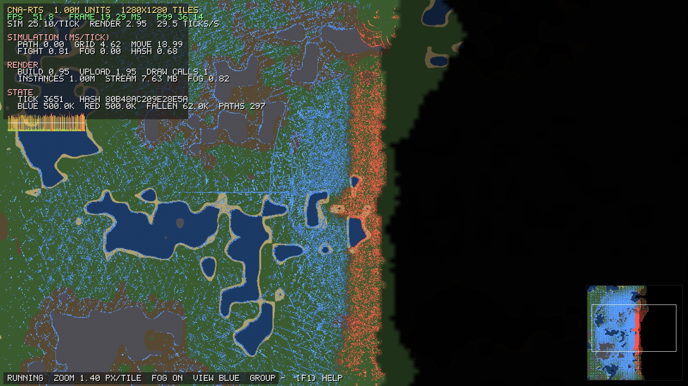
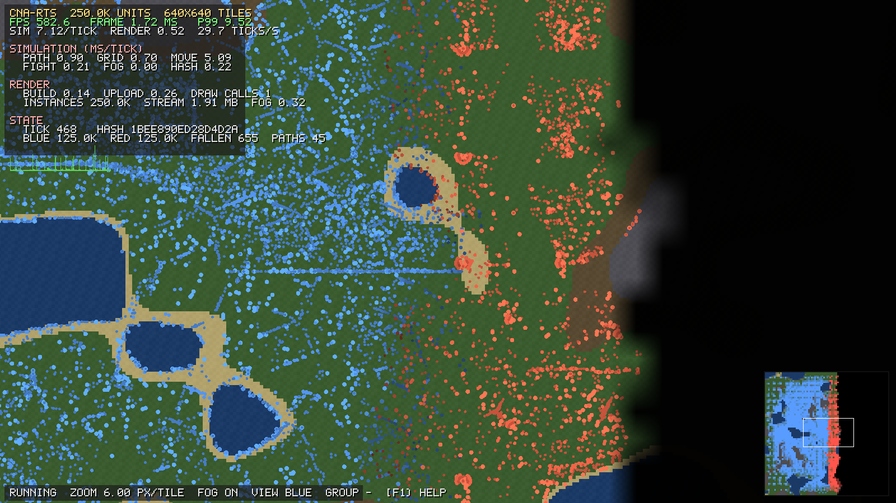

# cna-rts — One Million Units

An RTS benchmark whose only goal is to put an absurd number of units on the screen at once, built
on [CNA](../cnanext) — the C++ reimplementation of the XNA 4.0 programming model — and its
[sharp-runtime](../sharp-runtimenext) .NET base class library.

There is no economy, no tech tree and nothing to win. There are two armies of up to a million
soldiers, a generated map with lakes and cliffs between them, hierarchical pathfinding that moves
them around it, fog of war that hides what they cannot see, and a state hash that proves the whole
thing runs the same way twice.

## 10k / 100k / 1M entities



| Entities | Map | FPS | Frame ms | p99 ms | Sim ms/tick | Instance build ms | Upload ms | Draw calls | Stream MiB |
| ---: | ---: | ---: | ---: | ---: | ---: | ---: | ---: | ---: | ---: |
| 10k | 128x128 | **1537.8** | 0.65 | 1.38 | 0.33 | 0.02 | 0.02 | 1 | 0.08 |
| 100k | 416x416 | **285.9** | 3.50 | 8.07 | 2.43 | 0.10 | 0.19 | 1 | 0.76 |
| 1M | 1280x1280 | **39.8** | 25.15 | 46.09 | 21.74 | 0.55 | 1.85 | 1 | 7.63 |

Measured on screen at 1600x900, renderer OPENGLES3, 16 worker threads, seed 1, 22% blocked terrain, 2 teams x 4 groups, 600 frames per scale after 120 warm-up frames.

Every row is **one draw call**. The instance stream is the only per-frame cost that scales with
the army: eight bytes per unit, uploaded whole every frame.

AMD Ryzen 7 PRO 7840U (16 threads) with its integrated Radeon 780M, Mesa 25.0.7, Debian 13, GCC 14.2, Release build.


### The same run with no renderer

| Entities | Map | Ticks/s | Tick ms | Path ms | Grid ms | Move ms | Fight ms | Fog ms | Hash ms |
| ---: | ---: | ---: | ---: | ---: | ---: | ---: | ---: | ---: | ---: |
| 10k | 128x128 | **2676.1** | 0.37 | 0.02 | 0.11 | 0.16 | 0.05 | 0.00 | 0.02 |
| 100k | 416x416 | **464.7** | 2.15 | 0.04 | 0.32 | 1.57 | 0.11 | 0.01 | 0.09 |
| 1M | 1280x1280 | **41.7** | 23.99 | 0.12 | 4.45 | 17.64 | 0.94 | 0.08 | 0.75 |

Simulation only, no rendering: renderer none (headless), 16 worker threads, seed 1, 22% blocked terrain, 2 teams x 4 groups.

AMD Ryzen 7 PRO 7840U (16 threads) with its integrated Radeon 780M, Mesa 25.0.7, Debian 13, GCC 14.2, Release build.

The simulation table is where the shape of the cost shows: movement is two thirds of a tick at
every scale, the spatial sort is most of the rest, and pathfinding — the thing that would dominate
a naive design — is a tenth of a millisecond, because one query serves a hundred and twenty-five
thousand units.




---

## What is actually being demonstrated

| | |
| --- | --- |
| **GPU instancing** | One quad, one `DrawInstancedPrimitives` call, up to a million instances, eight bytes each. No per-unit CPU work in the draw. |
| **Spatial partitioning** | A uniform grid rebuilt from scratch every tick by counting sort, with the positions scattered alongside the indices so neighbour reads stay sequential. |
| **Fog of war** | Rasterised from *cell occupancy*, not from per-unit stamps, so its cost is independent of the army size. Sampled in the vertex shader, so hidden enemies are never submitted. |
| **Hierarchical pathfinding** | Sector portals with precomputed within-sector distances, A\* over the portal graph, and per-sector flow fields along the answer. One query serves a whole group. |
| **Formations** | Line, column, wedge, box and circle, as a pure function of the unit's index — no assignment pass and no per-unit state. |
| **Deterministic simulation** | Fixed-point arithmetic, a fixed time step, a fixed work partition, and an order-free state hash. `--verify` proves it across worker counts; `--record` / `--replay` proves it across runs. |

`ARCHITECTURE.md` explains how each of these works and, more usefully, why it is shaped the way it
is — most of these designs were forced by the scale rather than chosen for elegance.

---

## Building

`cna-rts` adds CNA as a CMake subdirectory. The default paths are `../cnanext` and
`../sharp-runtimenext`; set `CNA_RTS_CNA_DIR` and `CNA_SHARP_RUNTIME_ROOT` when using other
checkouts. With this workspace's `libcnalab` and `libcna` directories, build against the current
CNA and Sharp Runtime trees as follows:

```sh
cmake -S . -B build -DCMAKE_BUILD_TYPE=Release \
    -DCMAKE_CXX_COMPILER_LAUNCHER=ccache -DCMAKE_C_COMPILER_LAUNCHER=ccache \
    -DCNA_RTS_CNA_DIR="$(realpath ../../libcna/cna)" \
    -DCNA_SHARP_RUNTIME_ROOT="$(realpath ../../libcna/sharp-runtime)"
cmake --build build --parallel 8
```

Reuse the `build/` directory across sessions rather than reconfiguring from scratch — see the
workspace-root `CLAUDE.md` for why that matters here.

The default renderer is `OPENGLES3` on desktop and `WEBGL2` under Emscripten; both resolve to CNA's
EasyGL backend. Any renderer that reports `Instancing` and `MultiStreamVertexInput` and accepts
GLSL will work; one that does not gets a clear message instead of a blank screen.
The game requests XNA's `HiDef` graphics profile, which permits the benchmark's single draw call
to contain up to one million instances.

---

## Running

```sh
./build/cna-rts                       # interactive, 100k units
./build/cna-rts --units 1M            # interactive, a million
./build/cna-rts --bench               # the windowed table above, then exit
./build/cna-rts --sim-only            # the simulation table above, no window
./build/cna-rts --verify              # prove the run is deterministic
```

### Controls

| key | |
| --- | --- |
| `W A S D` / arrows | pan |
| mouse wheel | zoom about the cursor |
| middle drag | pan |
| left click | order the selected group to march there |
| right click | order every group of the viewing team there |
| `0`–`7` | select a group; `-` selects none |
| `F` | cycle the selected group's formation |
| `V` | switch the viewing team (blue / red / all) |
| `G` | toggle fog of war |
| `C` | toggle the camera that follows the fighting |
| `Space` | pause; `.` single-steps |
| `R` | reset the frame-time window |
| `F1` | help; `Esc` quits |

---

## Determinism, and how to check it

Every order — from the mouse or from the built-in AI — is stamped with the tick it takes effect on
and appended to a log. That is what makes a replay a replay rather than an approximation.

```sh
./build/cna-rts --verify                          # same seed, two different worker counts
./build/cna-rts --units 50k --record run.log      # play, then quit; the log lands in run.log
./build/cna-rts --replay run.log                  # the same run, hash for hash
```

`--verify` deliberately uses a *different* worker count for the second run. Two runs at the same
worker count would prove almost nothing; the failure mode worth catching is a result that depends
on how the work was divided.

The HUD shows the running state hash. Two runs of the same seed that show the same hash at the same
tick are the same run.

---

## Options

Run `cna-rts --help` for the authoritative list. The ones worth knowing:

### Scale and world

| flag | |
| --- | --- |
| `--units N` | units to simulate; `250000`, `250k` and `1M` all parse (default 100k) |
| `--map N` | map edge in tiles. The default keeps unit **density** constant instead — see below |
| `--blocked N` | percent of the map made impassable (22) |
| `--teams N` | playable teams, 2 or 3 (2) |
| `--groups N` | commanded groups per team (4) |
| `--seed N` | the same seed is the same run (1) |

### Simulation

| flag | |
| --- | --- |
| `--neighbours N` | separation partners examined per unit per tick (6); `0` leaves only the density gradient |
| `--vision N` | vision radius in grid cells (6) |
| `--fog-interval N` | ticks between fog-of-war rebuilds (4) |
| `--order-interval N` | ticks between a group's automatic orders (600) |
| `--paths-per-tick N` | abstract path queries serviced per tick (1) |
| `--checksum N\|off` | ticks between state hashes (1) |
| `--max-ticks N` | quit at simulation tick N — the tick count, not the frame count, so a `--record` run and its `--replay` stop in the same place |
| `--no-combat`, `--no-respawn` | |
| `--workers N` | worker threads; 0 asks the hardware |

### Presentation and benchmarking

| flag | |
| --- | --- |
| `--width`, `--height`, `--fullscreen`, `--vsync` | vsync is **off** by default: a benchmark measures work, not the monitor |
| `--zoom N` | pixels per tile; the default fits the whole map |
| `--viewer N` | team whose fog of war is shown; `-1` reveals everything |
| `--follow` | keep the camera on the fighting (on by default under `--bench`) |
| `--bench-scales LIST` | comma-separated unit counts (`10k,100k,1M`) |
| `--bench-frames N`, `--bench-warmup N` | measured and discarded frames per scale |
| `--bench-out FILE` | also write the markdown table there |
| `--screenshot FILE` | write a PNG of frame `--screenshot-frame` and exit |

---

## Why the map grows with the army

Density, not extent, is what the benchmark holds constant: the default map edge is
`1.25 × sqrt(units)` tiles, which is about one and a half tiles per unit at every scale.

If the map stayed the same size while the army grew a hundredfold, the 10k row would be measuring
an empty map and the 1M row a solid wall of units, and the two numbers would not be comparable —
neighbour counts per cell, path lengths, fog grid size and draw overdraw would all be moving at
once. Holding density fixed means the per-unit work is the same at every scale and the rows differ
only in how many units there are, which is the thing the table claims to measure.

Pass `--map N` to pin an edge length and measure the other axis instead.

---

## Reading the tables

**Windowed rows** (`--bench`) pin **one simulation tick per rendered frame**, so the FPS column
means "frames per second with the simulation running", not "frames per second of a paused world".
Interactive play does *not* do this — there the simulation runs at a fixed 30 Hz under a renderer
going as fast as it can, and the HUD reports both rates separately.

**Simulation rows** (`--sim-only`) open no window at all and report the tick cost broken down by
phase. Use them to see where simulation time actually goes; use the windowed rows for the headline.

`Stream MiB` is the per-frame instance upload: eight bytes per unit, which is the number the whole
renderer is designed around.

---

## Known boundaries

- **The instance stream is re-uploaded whole every frame.** There is no partial update and no GPU
  residency; a real game would keep static units resident and stream only what moved. Uploading
  everything is what makes the `Upload ms` column an honest measurement of the worst case.
- **CNA copies every buffer upload into a CPU shadow.** `VertexBuffer::SetData` keeps a
  host-side copy for context recovery, so the 8 MB stream at a million units is memcpy'd once on
  the way to the driver. That cost is in the `Upload ms` column and is CNA's, not this program's.
- **Combat is attrition, not tactics.** Damage is a function of the enemy population in a unit's
  own grid cell. It exists to make a battle happen and to keep the entity count constant through
  respawns, not to be interesting.
- **Fog of war is per-cell, not per-tile.** Vision resolves to the spatial grid's cell size
  (8 tiles by default), which is what makes it cost `O(cells)` instead of `O(units)`.
- **Formations dominate at the top scale.** With density held constant, eight groups of a
  hundred and twenty-five thousand units each occupy roughly the whole map, so at 1M nearly every
  unit is inside its formation's envelope and steering at a slot rather than following a flow
  field. Pathfinding does most of its visible work at 10k and 100k, where there is room to march.
- **The abstract path is approximate.** HPA\* with span-to-span portal distances does not always
  return the shortest tile-level route; it returns a good one, for a few dozen node expansions
  instead of four million.

---

## License

MIT — see [LICENSE](LICENSE).
